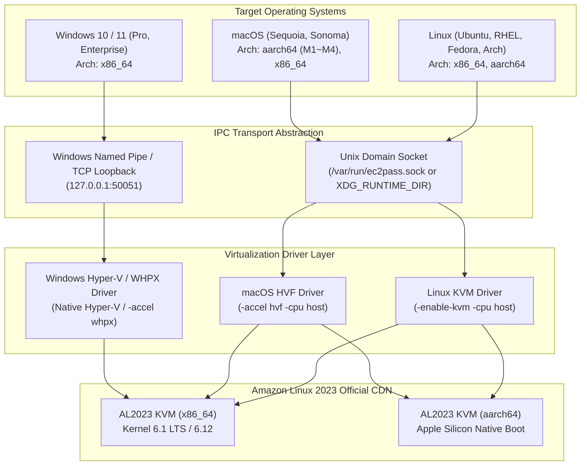

# InhausLab ec2pass
## Cross-Platform Architecture for Linux and macOS

---

## 1. Overview & Objectives

This document outlines the architecture and execution plan for expanding **InhausLab ec2pass**, the Amazon Linux 2023 virtualization orchestrator, across **Linux (KVM)**, **macOS (Apple Silicon M-series & Intel HVF)**, and **Windows (Hyper-V / WHPX)** from a single, unified Rust codebase with a consistent CLI experience.



---

## 2. Platform Differences and Gap Analysis

| Category | Windows | Linux | macOS |
| :--- | :--- | :--- | :--- |
| **Default Hypervisor** | Hyper-V / QEMU-WHPX | **KVM (`/dev/kvm`)** via QEMU | **Hypervisor.framework (`HVF`)** via QEMU |
| **CPU Architectures** | `x86_64` | `x86_64` and `aarch64` | **`aarch64` (Apple Silicon M1~M4)** and `x86_64` |
| **Daemon IPC Transport** | TCP Loopback (`127.0.0.1:50051`) / Named Pipe | **Unix Domain Socket (`.sock`)** (`/var/run` or `XDG_RUNTIME_DIR`) | **Unix Domain Socket (`.sock`)** (`/var/run` or `~/Library/Application Support`) |
| **File Permissions** | Windows ACL | **POSIX mode `0600`** (strict SSH key check) | **POSIX mode `0600`** (strict SSH key check) |
| **Interactive Shell (PTY)** | Standard I/O / Windows Console | **OpenSSH PTY Passthrough** (Terminal resize `SIGWINCH`, colors, completion) | **OpenSSH PTY Passthrough** |
| **Host Directory Mounts** | SFTP file synchronization | **VirtioFS (`vhost-user-fs`)** or SSHFS | **VirtioFS** or SSHFS |
| **Service Manager** | Windows Service / Background process | **Systemd Unit (`ec2passd.service`)** | **Launchd Plist (`com.inhauslab.ec2passd.plist`)** |
| **Package Distribution** | Standalone installer (`ec2pass-setup.exe`) / ZIP | Compressed tarball (`.tar.gz`), DEB, RPM | Universal 2 Binary (`.tar.gz`) / Homebrew |

---

## 3. Phased Implementation Roadmap

### Phase 1: IPC Sockets & POSIX Filesystem Abstraction
* **Goal**: Enable secure Unix Domain Sockets (UDS) and enforce POSIX filesystem requirements.
1. **Unix Domain Socket (UDS) Support**:
   - Windows: Maintain TCP loopback or Named Pipe.
   - Linux / macOS:
     - Root daemon: `/var/run/ec2pass.sock` (permissions `0660`, `ec2pass` group).
     - User session daemon: `$XDG_RUNTIME_DIR/ec2pass.sock` (Linux) or `~/Library/Application Support/ec2pass/ec2pass.sock` (macOS).
2. **POSIX SSH Private Key Permissions (`0600`)**:
   - Standard OpenSSH clients reject keys if file permissions are overly permissive.
   - Enforce `0600` permissions on key creation via `std::os::unix::fs::PermissionsExt` in `crates/ec2ps-core/src/ssh.rs`.

### Phase 2: Native Acceleration Drivers & QEMU Engine
* **Goal**: Utilize kernel-level hardware virtualization on every host OS without software emulation.
1. **Linux (KVM Backend)**:
   - Arguments: `-enable-kvm -cpu host`
   - Pre-flight check: Verify `/dev/kvm` read/write permissions for the current user.
2. **macOS (Apple HVF Backend)**:
   - Arguments: `-accel hvf -cpu host`
   - Apple Silicon (`aarch64`): QEMU machine type `-M virt,highmem=on -accel hvf -cpu host`.
   - EFI Firmware: Automated mapping for EDK2 ARM64 UEFI firmware (`QEMU_EFI.fd`).

### Phase 3: Apple Silicon (ARM64) Image Catalog & Auto-Detection
* **Goal**: Native ARM64 kernel boot on Apple Silicon without Rosetta translation.
1. **AWS CDN Architecture Resolution**:
   - `x86_64`: `https://cdn.amazonlinux.com/al2023/os-images/latest/kvm/`
   - `aarch64`: `https://cdn.amazonlinux.com/al2023/os-images/latest/kvm-arm64/`
2. **Dynamic Image Selection**:
   - On `aarch64` hosts, `ec2pass find` and `launch` automatically default to `al2023-kvm-*-kernel-6.1-arm64.xfs.gpt.qcow2`.

### Phase 4: Interactive Terminal Passthrough (PTY)
* **Goal**: Support full-screen interactive applications (`vim`, `htop`), window resizing (`SIGWINCH`), and ANSI colors during `ec2pass shell`.
1. Once the instance finishes booting and exposes its SSH port, invoke the host's native OpenSSH client (`/usr/bin/ssh`) as an interactive child process:
   ```bash
   ssh -i <key_path> -p <port> -o StrictHostKeyChecking=no ec2-user@127.0.0.1
   ```

### Phase 5: Daemon Service Management
* **Linux (Systemd)**:
  - Generate `/etc/systemd/system/ec2passd.service`:
    ```ini
    [Unit]
    Description=InhausLab ec2pass Virtualization Daemon
    After=network.target

    [Service]
    Type=simple
    ExecStart=/usr/local/bin/ec2passd
    Restart=always
    User=root

    [Install]
    WantedBy=multi-user.target
    ```
* **macOS (Launchd)**:
  - Provide `/Library/LaunchDaemons/com.inhauslab.ec2passd.plist` for system startup.

### Phase 6: Release Packaging and CI Matrix
* Target compilation matrix:
  - `x86_64-unknown-linux-gnu` / `x86_64-unknown-linux-musl`
  - `aarch64-unknown-linux-gnu`
  - `aarch64-apple-darwin` (Apple Silicon Mac)
  - `x86_64-apple-darwin` (Intel Mac)
  - `x86_64-pc-windows-msvc` (Windows)
* Bundle macOS Universal 2 binaries using `lipo`.

---

## 4. Key Architectural Code Patterns

### 4.1 IPC Transport Abstraction (`ec2ps-protocol`)
```rust
#[derive(Debug, Clone)]
pub enum IpcEndpoint {
    Tcp(String),
    #[cfg(unix)]
    UnixSocket(std::path::PathBuf),
}

impl IpcEndpoint {
    pub fn default_endpoint() -> Self {
        #[cfg(unix)]
        {
            if let Ok(runtime_dir) = std::env::var("XDG_RUNTIME_DIR") {
                return Self::UnixSocket(std::path::PathBuf::from(runtime_dir).join("ec2pass.sock"));
            }
            Self::UnixSocket(std::path::PathBuf::from("/var/run/ec2pass.sock"))
        }
        #[cfg(not(unix))]
        {
            Self::Tcp("127.0.0.1:50051".to_string())
        }
    }
}
```

### 4.2 Platform-Specific Hypervisor Arguments (`ec2ps-core`)
```rust
pub fn build_platform_qemu_args(rec: &InstanceRecord) -> Vec<String> {
    let mut args = vec![...];

    #[cfg(target_os = "linux")]
    {
        args.extend(["-enable-kvm".into(), "-cpu".into(), "host".into()]);
    }

    #[cfg(target_os = "macos")]
    {
        args.extend(["-accel".into(), "hvf".into()]);
        if cfg!(target_arch = "aarch64") {
            args.extend([
                "-M".into(), "virt,highmem=on".into(),
                "-cpu".into(), "host".into(),
                "-bios".into(), "/usr/share/qemu/edk2-aarch64-code.fd".into(),
            ]);
        } else {
            args.extend(["-cpu".into(), "host".into()]);
        }
    }

    #[cfg(target_os = "windows")]
    {
        args.extend(["-accel".into(), "whpx".into()]);
    }

    args
}
```

### 4.3 SSH Key Security Permissions (`ec2ps-core`)
```rust
#[cfg(unix)]
fn set_strict_key_permissions(path: &std::path::Path) -> Result<()> {
    use std::os::unix::fs::PermissionsExt;
    std::fs::set_permissions(path, std::fs::Permissions::from_mode(0o600))?;
    Ok(())
}

#[cfg(not(unix))]
fn set_strict_key_permissions(_path: &std::path::Path) -> Result<()> {
    Ok(())
}
```

---

## 5. Porting Milestones

| Milestone | Scope | Deliverable |
| :--- | :--- | :--- |
| **M1: IPC & POSIX Fundamentals** | Unix Domain Sockets, file permissions (`0600`), path resolvers | Verified Unix socket client-daemon communication |
| **M2: Linux KVM Backend** | `/dev/kvm` checks, QEMU KVM arguments, automated testing | Native AL2023 boot on Linux hosts |
| **M3: macOS HVF Backend** | HVF accelerator, aarch64 EDK2 UEFI firmware, ARM64 CDN images | Native AL2023 boot on Apple Silicon (M1~M4) |
| **M4: PTY Terminal Passthrough** | Host OpenSSH client integration for interactive sessions | Full interactive terminal support (`vim`, `htop`, resize) |
| **M5: Daemon & Packaging** | Systemd unit, Launchd plist, macOS Universal 2 binary packaging | Multi-platform production release bundles |
