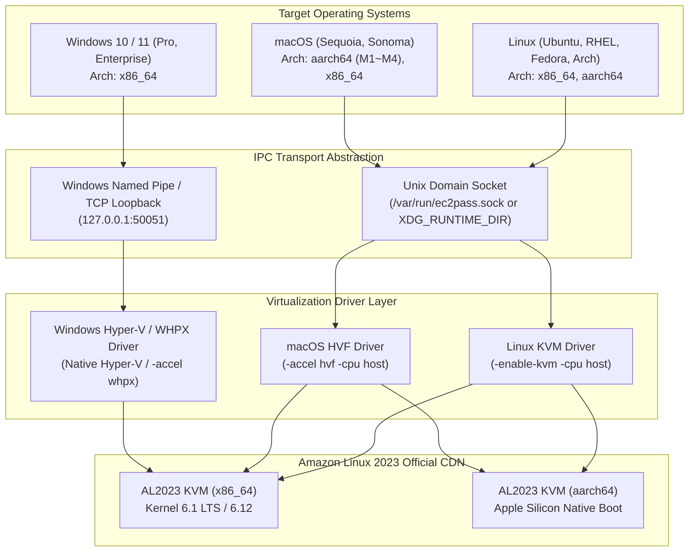

# InhausLab ec2pass (`ec2pass` / `multipass`)
## Linux 및 macOS 완전 지원을 위한 크로스 플랫폼 포팅 계획서

---

## 1. 개요 및 포팅 목표

본 계획서는 현재 Windows(Hyper-V / QEMU-WHPX) 기반으로 검증된 **Amazon Linux 2023 가상화 오케스트레이터 (`ec2pass` / `multipass`)**를 **Linux(KVM)** 및 **macOS(Apple Silicon M-series & Intel HVF)** 환경으로 확장하여, 모든 플랫폼에서 단일 코드베이스 및 100% 동일한 CLI 경험을 제공하기 위한 종합 이행 계획입니다.



---

## 2. 플랫폼별 차이점 분석 및 포팅 과제 (Gap Analysis)

| 영역 | Windows (현재 구현) | Linux 포팅 요구사항 | macOS 포팅 요구사항 |
| :--- | :--- | :--- | :--- |
| **기본 하이퍼바이저** | Hyper-V (PowerShell) / QEMU-WHPX | **KVM (`/dev/kvm`)** via QEMU | **Hypervisor.framework (`HVF`)** via QEMU / Apple Virtualization |
| **CPU 아키텍처** | 대부분 `x86_64` | `x86_64` 및 `aarch64` | **`aarch64` (Apple Silicon M1~M4 필수)** 및 `x86_64` |
| **IPC 통신 (데몬 $\leftrightarrow$ CLI)** | TCP 루프백 (`127.0.0.1:50051`) | **Unix Domain Socket (`.sock`)** (루트 또는 XDG_RUNTIME_DIR) | **Unix Domain Socket (`.sock`)** (`/var/run/` 또는 `~/Library/Caches/`) |
| **파일 권한 관리** | Windows ACL (특수 권한 플래그) | **POSIX 파일 모드 (`chmod 0600`)** - SSH 개인키 필수 | **POSIX 파일 모드 (`chmod 0600`)** - SSH 개인키 필수 |
| **대화형 셸 (PTY)** | 표준 입출력 스트리밍 / 콘솔 모드 | **OpenSSH PTY Passthrough** (터미널 크기 조정 `SIGWINCH`, 색상, 탭 자동완성) | **OpenSSH PTY Passthrough** |
| **호스트 디렉터리 마운트** | SFTP 파일 복사 및 Windows 경로 | **VirtioFS (`vhost-user-fs`)** 또는 SSHFS | **VirtioFS** 또는 SSHFS |
| **백그라운드 데몬 서비스** | Windows 서비스 / Background 프로세스 | **Systemd Unit (`ec2passd.service`)** | **Launchd Plist (`com.amazonlinux.ec2passd.plist`)** |
| **패키지 배포 방식** | 바이너리 직접 실행 / winget | DEB, RPM, Arch AUR, Snap | **Homebrew Tap (`brew install ec2pass`)** |

---

## 3. 단계별 상세 이행 계획 (Phased Execution)

### Phase 1: IPC 소켓 및 크로스 플랫폼 스토리지 추상화
* **목표**: Linux/macOS 표준에 맞는 안전한 프로세스 간 통신(IPC) 및 POSIX 디렉터리 경로 처리.
1. **Unix Domain Socket (UDS) 지원**:
   * Windows: 기존의 TCP 루프백 또는 Named Pipe 유지.
   * Linux/macOS:
     * 시스템 전역 데몬(root): `/var/run/ec2pass.sock` (퍼미션 `0660`, `ec2pass` 그룹 소유).
     * 사용자 모드 데몬: `$XDG_RUNTIME_DIR/ec2pass.sock` (Linux) 또는 `~/Library/Application Support/ec2pass/ec2pass.sock` (macOS).
2. **POSIX SSH 개인키 권한 강제 (`0600`)**:
   * OpenSSH 클라이언트는 개인키 권한이 `0600`이 아닐 경우 보안 경고와 함께 접속을 거부합니다.
   * `ec2pass-core/src/ssh.rs`에 `std::os::unix::fs::PermissionsExt`를 적용하여 키 생성 시 즉시 `0600` 권한 부여.

### Phase 2: 네이티브 가속 드라이버 분기 및 QEMU 최적화
* **목표**: 각 OS의 커널 레벨 하이퍼바이저를 100% 활용하여 하드웨어 직접 실행 속도 달성.
1. **Linux (KVM 백엔드)**:
   * 실행 옵션: `-enable-kvm -cpu host`
   * `/dev/kvm` 권한 검사: 현재 사용자가 `kvm` 그룹에 속해 있는지 사전 점검 및 안내 메시지 출력.
2. **macOS (Apple HVF 백엔드)**:
   * 실행 옵션: `-accel hvf -cpu host`
   * Apple Silicon (`aarch64`)의 경우 QEMU 머신 타입을 `-M virt,highmem=on -accel hvf -cpu host`로 분기.
   * EFI 펌웨어: ARM64 가상 머신 부팅을 위한 `QEMU_EFI.fd` (EDK2 ARM64 UEFI) 자동 매핑.

### Phase 3: Apple Silicon (ARM64) 이미지 카탈로그 및 CDN 자동 감지
* **목표**: M1/M2/M3/M4 Mac에서 Rosetta 에뮬레이션 없이 네이티브 ARM64 커널로 1초 내 부팅.
1. **AWS CDN 아키텍처별 경로 분기**:
   * `x86_64`: `https://cdn.amazonlinux.com/al2023/os-images/latest/kvm/`
   * `aarch64`: `https://cdn.amazonlinux.com/al2023/os-images/latest/kvm-arm64/`
2. **`ec2pass find` 및 `launch` 자동 매칭**:
   * 호스트 CPU가 Apple Silicon일 경우 `al2023-kvm-*-kernel-6.1-arm64.xfs.gpt.qcow2`를 기본 다운로드 대상으로 자동 설정.

### Phase 4: 대화형 터미널 (Interactive PTY Passthrough)
* **목표**: `ec2pass shell` 실행 시 실제 SSH 클라이언트처럼 터미널 크기 변경, `vim`/`htop` 등의 풀스크린 ncurses 앱, 한글 입력, ANSI 컬러를 완벽 지원.
1. Windows: 기존 터미널 스트리밍 또는 OpenSSH Windows 바이너리 직접 연동.
2. Linux/macOS:
   * 인스턴스가 부팅되어 SSH 포트가 열리면 데몬 내부 SSH가 아닌 호스트 시스템의 표준 OpenSSH 바이너리(`/usr/bin/ssh`)를 인터랙티브 PTY 세션으로 `execve` 또는 자식 프로세스로 즉시 연결.
   * `ssh -i <key> -p <port> -o StrictHostKeyChecking=no ec2-user@127.0.0.1`

### Phase 5: 데몬 서비스 등록 및 데몬 자동 관리
* **Linux (Systemd)**:
  * `/etc/systemd/system/ec2passd.service` 생성:
    ```ini
    [Unit]
    Description=Amazon Linux 2023 Multipass Daemon
    After=network.target

    [Service]
    Type=simple
    ExecStart=/usr/local/bin/ec2passd
    Restart=always
    User=root

    [Install]
    WantedBy=multi-user.target
    ```
* **macOS (Launchd)**:
  * `/Library/LaunchDaemons/com.amazonlinux.ec2passd.plist` 생성하여 부팅 시 자동 기동 지원.

### Phase 6: 패키징 및 CI/CD 크로스 컴파일
* GitHub Actions 매트릭스 빌드 파이프라인 구성:
  * `x86_64-unknown-linux-gnu` / `x86_64-unknown-linux-musl`
  * `aarch64-unknown-linux-gnu`
  * `aarch64-apple-darwin` (Apple Silicon Mac)
  * `x86_64-apple-darwin` (Intel Mac)
  * `x86_64-pc-windows-msvc` (Windows)
* 배포 아티팩트:
  * macOS: Homebrew Formula (`brew install ec2pass`)
  * Linux: `install.sh` 원클릭 스크립트 및 `.deb` / `.rpm` 패키지 생성.

---

## 4. 핵심 코드 리팩토링 설계 (Code Changes)

### 4.1 IPC 트랜스포트 추상화 (`ec2pass-protocol` / `ec2pass-daemon` / `ec2pass-cli`)
```rust
// 크로스 플랫폼 소켓 엔드포인트
#[derive(Debug, Clone)]
pub enum IpcEndpoint {
    Tcp(String),
    #[cfg(unix)]
    UnixSocket(std::path::PathBuf),
}

impl IpcEndpoint {
    pub fn default_endpoint() -> Self {
        #[cfg(unix)]
        {
            if let Ok(runtime_dir) = std::env::var("XDG_RUNTIME_DIR") {
                return Self::UnixSocket(std::path::PathBuf::from(runtime_dir).join("ec2pass.sock"));
            }
            Self::UnixSocket(std::path::PathBuf::from("/var/run/ec2pass.sock"))
        }
        #[cfg(not(unix))]
        {
            Self::Tcp("127.0.0.1:50051".to_string())
        }
    }
}
```

### 4.2 Linux & macOS QEMU 실행 인자 빌더 분기 (`ec2pass-core/src/driver.rs`)
```rust
pub fn build_platform_qemu_args(rec: &InstanceRecord) -> Vec<String> {
    let mut args = vec![...];

    #[cfg(target_os = "linux")]
    {
        args.extend(["-enable-kvm".into(), "-cpu".into(), "host".into()]);
    }

    #[cfg(target_os = "macos")]
    {
        args.extend(["-accel".into(), "hvf".into()]);
        if cfg!(target_arch = "aarch64") {
            // Apple Silicon (ARM64)
            args.extend([
                "-M".into(), "virt,highmem=on".into(),
                "-cpu".into(), "host".into(),
                "-bios".into(), "/usr/share/qemu/edk2-aarch64-code.fd".into(),
            ]);
        } else {
            args.extend(["-cpu".into(), "host".into()]);
        }
    }

    #[cfg(target_os = "windows")]
    {
        args.extend(["-accel".into(), "whpx".into(), "-accel".into(), "tcg".into()]);
    }

    args
}
```

### 4.3 SSH 개인키 권한 설정 (`ec2pass-core/src/ssh.rs`)
```rust
#[cfg(unix)]
fn set_strict_key_permissions(path: &std::path::Path) -> Result<()> {
    use std::os::unix::fs::PermissionsExt;
    std::fs::set_permissions(path, std::fs::Permissions::from_mode(0o600))?;
    Ok(())
}

#[cfg(not(unix))]
fn set_strict_key_permissions(_path: &std::path::Path) -> Result<()> {
    Ok(())
}
```

---

## 5. 포팅 일정 및 마일스톤

| 마일스톤 | 작업 항목 | 소요 기간 (예상) | 산출물 |
| :--- | :--- | :---: | :--- |
| **M1: IPC & POSIX 기초** | Unix Domain Socket 지원, 파일 권한(0600), 디렉터리 경로 정리 | 3일 | Unix 소켓 클라이언트/데몬 통신 검증 |
| **M2: Linux KVM 연동** | `/dev/kvm` 하드웨어 가속, QEMU KVM 아규먼트 연동, Linux 테스트 | 2일 | Ubuntu/Fedora 호스트에서 실제 KVM AL2023 부팅 |
| **M3: macOS Apple Silicon** | HVF 가속기 연동, aarch64 EDK2 펌웨어 지원, ARM64 CDN 이미지 매핑 | 3일 | M1~M4 Mac에서 네이티브 AL2023 인스턴스 구동 |
| **M4: PTY Passthrough** | `ec2pass shell` 네이티브 OpenSSH PTY 바이너리 직접 실행 연동 | 2일 | 풀 터미널(vim, htop, bash 자동완성) 동작 |
| **M5: 서비스 & 패키징** | Systemd 서비스, Launchd 데몬, Homebrew Formula, CI 매트릭스 구성 | 3일 | GitHub Actions 멀티 플랫폼 자동 릴리스 빌드 |
| **합계** | **전체 포팅 완료** | **약 2주 (13 MD)** | **Win / Linux / macOS 완전 통합 바이너리** |
